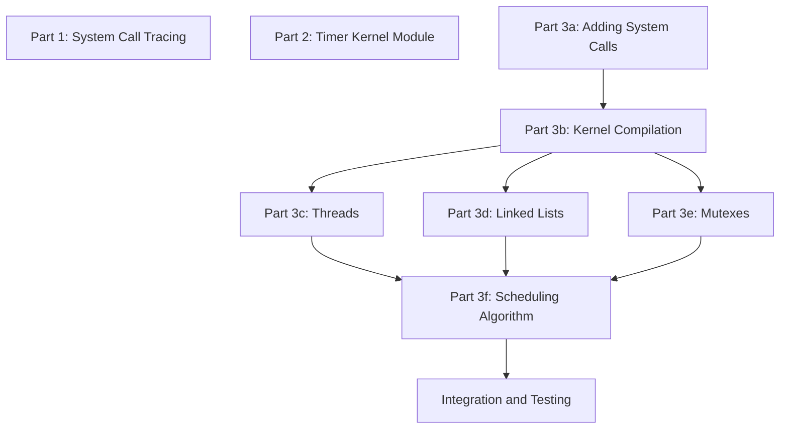

# [COP4610Proj2]

[Description]

## Group Members
- **[John Simson]**: jrs22bf@fsu.edu
- **[Riley Galpin]**: rg22bf@fsu.edu
- **[Taylor Vaughn]**: tmv22a@fsu.edu

## Kernel Versions & Ubuntu Versions:
Everyone Run: 
```bash
lsb_release -a
uname -r
uname -m
```

- **John Simson**: 
```bash
No LSB modules are available.
Distributor ID: Ubuntu
Description:    Ubuntu 26.04.1 LTS
Release:        26.04
Codename:       resolute
6.16.0-elevator-amd64
x86_64
```

- **Riley Galpin**: 
```bash
6.16.0-elevator
aarch64
```
- **Taylor Vaughn**:
```bash
No LSB modules are available.
Distributor ID:	Ubuntu
Description:	Ubuntu 26.04.1 LTS
Release:	26.04
Codename:	resolute
7.0.0-42-generic
x86_64
```

## Division of Labor (after)

Team Members:
1. Riley Galpin
2. Taylor Vaughn
3. John Simson 

Part 1: System Call Tracing [Done: Y , Tested: Y]
- Riley Galpin

Part 2: Timer Kernel Module [Done: Y, Tested: Y]
- Taylor Vaughn

Part 3a: Adding System Calls [Done: Y, Tested: Y]
- Riley Galpin, John Simson

Part 3b: Kernel Compilation [Done: Y , Tested: Y]
- Riley Galpin   - John Simson

Part 3c: Threads [Done: Y, Tested:]
- John Simson

Part 3d: Linked List [Done: Y, Tested: Y]
- Taylor Vaughn, John Simson

Part 3e: Mutexes [Done: Y, Tested: Y]
-Taylor Vaughn, John Simson

Part 3f: Scheduling Algorithm [Done: Y, Tested: Y]
- John Simson 

## General Dev Dependency Graph



## File Listing
```
.
├── part1/
│   ├── empty.c
│   └── part1.c
├── part2/
│   ├── Makefile
│   └── src/
│       └── my_timer.c
├── part3/
│   ├── Makefile
│   ├── syscalls.c
│   ├── src/
│   │   ├── elevator.c
│   │   ├── elevator.h
│   │   └── Makefile
│   └── tests/
│       └── elevator-test/
│           ├── producer.c
│           ├── consumer.c
│           ├── wrappers.h
│           └── Makefile
└── README.md
```
## How to Compile & Execute

### Requirements
- **Compiler and build tools**: `gcc`, `make`, and standard build utilities
- **Kernel source or a provided custom-kernel release** containing syscalls
    548, 549, and 550
- **Matching architecture** between the kernel, module, and machine
- **Root access** for kernel installation, module loading, and module removal
- **Booted custom kernel** before compiling or loading `elevator.ko`

## Building and Running

### Prerequisites

Install the tools needed to download, configure, compile, package, and test a
custom Linux kernel:

```bash
sudo apt update
sudo apt install build-essential bc bison flex libssl-dev libelf-dev \
    libncurses-dev dwarves rsync cpio kmod fakeroot git wget xz-utils strace
```

Package purposes include:

- `build-essential`, `bc`, `bison`, and `flex`: kernel and C compilation
- `libncurses-dev`: `make menuconfig`
- `libssl-dev` and `libelf-dev`: kernel cryptography and ELF support
- `dwarves`: optional BTF generation during kernel/module builds
- `rsync`, `cpio`, and `kmod`: module and initramfs installation support
- `fakeroot`: optional Debian kernel packages with `make bindeb-pkg`
- `git`, `wget`, and `xz-utils`: obtaining and unpacking kernel sources
- `strace`: Part 1 system-call tracing

For a normal stock-kernel module build, matching Ubuntu headers can be
installed with:

```bash
sudo apt install linux-headers-$(uname -r)
```

For this project, `elevator.ko` must instead be built against the custom
kernel that contains the project system calls. After booting that kernel,
verify that matching headers or the kernel build tree are available:

```bash
uname -r
uname -m
ls -l /lib/modules/$(uname -r)/build
```

The final command must resolve to the matching custom-kernel build tree. Do
not build `elevator.ko` against stock-kernel headers and then load it into the
custom kernel. If the custom kernel was installed from Debian packages, install
the matching custom `linux-headers` package as well as the `linux-image`
package. The deb packages will be included in the release. 

(According to Copilot) If the custom kernel was built from source, the
`/lib/modules/$(uname -r)/build` symlink must point to the kernel build tree
used to compile the custom kernel. The `elevator.ko` module must be built
against the same kernel build tree that was used to compile the custom kernel.

### Part 1: System-Call Tracing

```bash
cd part1

gcc -o empty empty.c
strace -o empty.trace ./empty

gcc -o part1 part1.c
strace -o part1.trace ./part1
```

`part1.trace` should have exactly 5 more lines than `empty.trace`:

```bash
wc -l empty.trace part1.trace
```
### Part 2: Timer Kernel Module (`my_timer`)

**Build** (run from `part2/src`, where `my_timer.c` and the `Makefile` live):

```bash
cd part2
make
```

This produces `my_timer.ko`.

**Load the module:**

```bash
sudo insmod my_timer.ko
lsmod | grep my_timer
```

**Test:**

```bash
cat /proc/timer
sleep 1
cat /proc/timer
sleep 3
cat /proc/timer
```

Expected output (your timestamps will differ):

```
current time: 1518647111.760933999
current time: 1518647112.768429998
elapsed time: 1.007495999
current time: 1518647115.774925999
elapsed time: 3.006496001
```

**Unload and clean up:**

```bash
sudo rmmod my_timer
ls /proc/timer        # should say "No such file or directory"
make clean
```

**Debugging:** `printk` output shows up in:

```bash
sudo dmesg | tail
```

### Part 3: Elevator Kernel Module (`elevator`)

Part 3 has two components:

1. The custom kernel contains system calls 548, 549, and 550.
2. `elevator.ko` contains the elevator implementation and registers the
    callbacks used by those system calls.

The elevator module cannot be used with a stock Ubuntu kernel. The machine
must be booted into a custom kernel that includes these system calls:

```bash
uname -r
uname -m
```

The module Makefile uses the headers for the currently running kernel:
`/lib/modules/$(uname -r)/build`. Therefore, build the module only after
booting the matching custom kernel. The kernel and module must also have the
same architecture. An AMD64 module/kernel cannot be installed on an ARM64
machine.

#### Build the elevator module

From the repository root:

```bash
cd part3
make clean
make
```

The expected output is:

```text
part3/src/elevator.ko
```

Confirm that the module matches the running kernel:

```bash
modinfo part3/src/elevator.ko
ls -l /lib/modules/$(uname -r)/build
```

#### Load and inspect the module

```bash
sudo insmod part3/src/elevator.ko
lsmod | grep '^elevator'
cat /proc/elevator
```

Immediately after loading, `/proc/elevator` should report:

- State: `OFFLINE`
- Current floor: `1`
- Current load: `0 lbs`
- No onboard pets
- No waiting pets

#### Use the user-space controls

The producer and consumer programs are included in
`part3/tests/elevator-test/`. They call syscall numbers 548, 549, and 550
through `wrappers.h`.

Build them with:

```bash
cd part3/tests/elevator-test
make
```

The producer creates random requests using floors 1 through 5 and pet types 0 through 3. The consumer starts or stops the elevator:

```bash
./consumer --start
./producer 10
cat /proc/elevator
./consumer --stop
```

`start_elevator()` returns `0` for a successful start and `1` when the
elevator is already active. `stop_elevator()` returns `0` when shutdown begins
and `1` when shutdown is already in progress. Shutdown is asynchronous: wait
until `/proc/elevator` reports `OFFLINE` and `Number of pets: 0` before
unloading the module.

Monitor movement in another terminal:

```bash
watch -n 1 cat /proc/elevator
```

#### Stop and unload cleanly

```bash
./consumer --stop
watch -n 1 cat /proc/elevator
```

Once the elevator is empty and `OFFLINE`:

```bash
sudo rmmod elevator
test ! -e /proc/elevator && echo "elevator removed successfully"
make clean
cd ../..
make clean
```

Do not run the producer or consumer on a stock kernel. The necessary kernel is included as a release in the github release. The syscall numbers
548, 549, and 550 only have the expected meaning in the custom kernel. If a
module or syscall operation fails, collect the kernel log:

```bash
dmesg | tail -50
```

The syscall source in `part3/syscalls.c` is integrated into the custom kernel;
it is not a separate `syscalls.ko` that must be loaded before `elevator.ko`.
The grader must either boot the provided matching custom kernel or build the
custom kernel from the project instructions before testing the module.

## Development Log
Each member records their contributions here.

### Riley Galpin

| Date       | Work Completed / Notes |
|------------|------------------------|
| 2026-10-18 | Completed part 1 System call Tracing  |
| 2026-10-19 | Completed part 3a Add System Calls|
| 2026-10-20 | Completed part 3b Compile Kernel |

### Taylor Vaughn

| Date       | Work Completed / Notes |
|------------|------------------------|
| 2026-10-31 | Completed part 2 timer  |
| 2026-10-31 | Completed part 3d linked list  |
| 2026-10-31 | Completed part 3e mutexes  |


### John Simson

| Date       | Work Completed / Notes |
|------------|------------------------|
| 2026-11-03 | Worked on documentation |
| 2026-11-04 | Updated Dev Dependency graph |
| 2026-11-05 | Recompiled Kernel for AMD64, Tested functionality. Worked on threads, mutexes, scheduling for elevator. Made producer.c and consumer.c for elevator testing. |


## Meetings
Document in-person meetings, their purpose, and what was discussed.

| Date       | Attendees            | Topics Discussed | Outcomes / Decisions |
|------------|----------------------|------------------|-----------------------|
| 2026-10-14 | Taylor Vaughn, John Simson, Riley Galpin              | Division of labor   | Discussed the project and how to divide work. Started on parts 1, 3a and 3b.  |
| 2026-10-28 | Taylor Vaughn, John Simson, Riley Galpin              | Discussed project progress   | Discussed which parts of project to complete next and planned timeframe for project completion.  |


## Bugs
- **Bug 1**: This is bug 1.
- **Bug 2**: This is bug 2.
- **Bug 3**: This is bug 3.

## Considerations
[Description]
