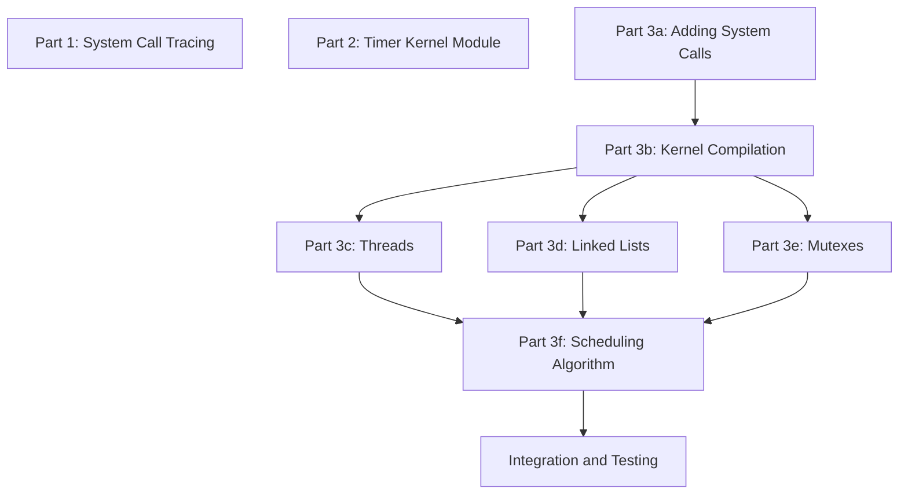

# [COP4610Proj2]

[Description]

## Group Members
- **[John Simson]**: [School Email]
- **[Riley Galpin]**: [School Email]
- **[Taylor Vaughn]**: [School Email]

## Kernel Versions & Ubuntu Versions:
Everyone Run: 
```bash
lsb_release -a
uname -r
uname -m
```

- **John Simson**: 
```bash
No LSB modules are available.
Distributor ID:	Ubuntu
Description:	Ubuntu 26.04.1 LTS
Release:	26.04
Codename:	resolute
7.0.0-42-generic
x86_64
```

- **Riley Galpin**: 
```bash
6.16.0-elevator
aarch64
```
- **Taylor Vaughn**:

## Division of Labor (after)

Team Members:
1. Riley Galpin
2. Taylor Vaughn
3. John Simson 

Part 1: System Call Tracing [Done: Y , Tested: Y]
- Riley Galpin

Part 2: Timer Kernel Module [Done: , Tested:]
- Taylor Vaughn

Part 3a: Adding System Calls [Done: Y, Tested: Y]
- Riley Galpin, John Simson

Part 3b: Kernel Compilation [Done: Y , Tested: Y]
- Riley Galpin   - John Simson

Part 3c: Threads [Done: Y, Tested:]
- John Simson

Part 3d: Linked List [Done: Y, Tested:]
- Taylor Vaughn, John Simson

Part 3e: Mutexes [Done: Y, Tested:]
-Taylor Vaughn, John Simson

Part 3f: Scheduling Algorithm [Done: Y, Tested:]
- John Simson 

## General Dev Dependency Graph



## File Listing
```
.
├── part1/
│   ├── empty.c
│   └── part1.c
├── part2/
│   ├── Makefile
│   └── src/
│       └── my_timer.c
├── part3/
│   ├── Makefile
│   ├── syscalls.c
│   └── src/
│       ├── elevator.c
│       ├── elevator.h
│       └── Makefile
└── README.md
```
## How to Compile & Execute

### Requirements
- **Compiler**: e.g., `gcc` for C/C++

## Building and Running

### Prerequisites

```bash
sudo apt update
sudo apt install build-essential strace linux-headers-$(uname -r)
```

### Part 1: System-Call Tracing

```bash
cd part1

gcc -o empty empty.c
strace -o empty.trace ./empty

gcc -o part1 part1.c
strace -o part1.trace ./part1
```

`part1.trace` should have exactly 5 more lines than `empty.trace`:

```bash
wc -l empty.trace part1.trace
```
### Part 2: Timer Kernel Module (`my_timer`)

**Build** (run from `part2/src`, where `my_timer.c` and the `Makefile` live):

```bash
cd part2/src
make
```

This produces `my_timer.ko`.

**Load the module:**

```bash
sudo insmod my_timer.ko
lsmod | grep my_timer
```

**Test:**

```bash
cat /proc/timer
sleep 1
cat /proc/timer
sleep 3
cat /proc/timer
```

Expected output (your timestamps will differ):

```
current time: 1518647111.760933999
current time: 1518647112.768429998
elapsed time: 1.007495999
current time: 1518647115.774925999
elapsed time: 3.006496001
```

**Unload and clean up:**

```bash
sudo rmmod my_timer
ls /proc/timer        # should say "No such file or directory"
make clean
```

**Debugging:** `printk` output shows up in:

```bash
sudo dmesg | tail
```

## Development Log
Each member records their contributions here.

### Riley Galpin

| Date       | Work Completed / Notes |
|------------|------------------------|
| YYYY-MM-DD | [Description of task]  |
| YYYY-MM-DD | [Description of task]  |
| YYYY-MM-DD | [Description of task]  |

### Taylor Vaughn

| Date       | Work Completed / Notes |
|------------|------------------------|
| YYYY-MM-DD | [Description of task]  |
| YYYY-MM-DD | [Description of task]  |
| YYYY-MM-DD | [Description of task]  |


### John Simson

| Date       | Work Completed / Notes |
|------------|------------------------|
| 2026-11-03 | [Description of task]  |
| 2026-11-04 | [Description of task]  |
| 2026-11-05 | [Description of task]  |


## Meetings
Document in-person meetings, their purpose, and what was discussed.

| Date       | Attendees            | Topics Discussed | Outcomes / Decisions |
|------------|----------------------|------------------|-----------------------|
| YYYY-MM-DD | [Names]              | [Agenda items]   | [Actions/Next steps]  |
| YYYY-MM-DD | [Names]              | [Agenda items]   | [Actions/Next steps]  |


## Bugs
- **Bug 1**: This is bug 1.
- **Bug 2**: This is bug 2.
- **Bug 3**: This is bug 3.

## Extra Credit
- **Extra Credit 1:**: [Extra Credit Option]
- **Extra Credit 2:**: [Extra Credit Option]
- **Extra Credit 3:**: [Extra Credit Option]

## Considerations
[Description]
